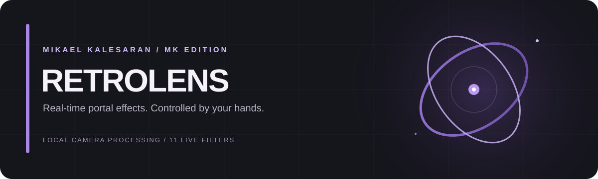

  

# Retrolens — MK Edition

**A real-time camera playground that turns hand gestures into a visual portal.**

Retrolens applies live visual filters to the area framed by your hands. Move naturally, switch looks with a pinch, and save a frame when you get a shot you like.

**Release 1.0.0 · Product edition and modifications by Mikael Kalesaran · 2026**

## Start in a few clicks

You do **not** need to type commands in Terminal or Command Prompt.

1. Download this repository as a ZIP and extract the folder first.
2. Open the launcher for your computer:
   - **macOS:** double-click `Start Retrolens.command`.
   - **Windows 64-bit:** double-click `Start Retrolens.bat`.
3. On first launch, the launcher prepares the compatible Python environment and installs the required components automatically. This first setup needs an internet connection. Allow camera access when prompted.
4. From then on, open the same launcher whenever you want to use Retrolens.

If macOS blocks the launcher, Control-click it and choose **Open**. The launcher may open the official Python installer once if Python 3.11 is not installed; complete that normal installer window and the setup will continue automatically.

## Make something

- **Shape a portal:** bring both hands into the camera frame and use your thumb/index-finger positions to define the portal.
- **Switch the look:** pinch your thumb and pinky together once to advance to the next filter. Release before pinching again.
- **Try 3D mode:** close both fists, or press `C`.
- **Change filters manually:** press `N` for next or `P` for previous.
- **Save a frame:** press `S`. Images are saved locally in the `Captures` folder.
- **Quit:** press `Q` or `Esc`.

## Included looks

Dual-tone · Thermal · Sketch · Pixelate · Glitch · Invert · Red channel · Edge · Blur · Cartoon · Rainbow wave

## Compatibility notes

- macOS on Apple Silicon or Intel, plus Windows 64-bit.
- A working webcam and a well-lit space give the best tracking results.
- The bundled launcher uses an isolated Python 3.11 environment; it does not replace or change your other Python installations.
- Camera frames are processed on your computer. Retrolens does not upload them; a screenshot is written only when you press `S`.

## Credits & Attribution

Retrolens MK Edition is a customized derivative of [Retrolens](https://github.com/syahdanfx/Retrolens), originally created by Syahdan FX.

This edition includes modifications, optimizations, branding, and distribution tools by Mikael Kalesaran.

The original project is distributed under the MIT License. The original copyright and license notices are retained in accordance with its terms.

Modifications and original contributions specific to MK Edition:
Copyright © 2026 Mikael Kalesaran.
